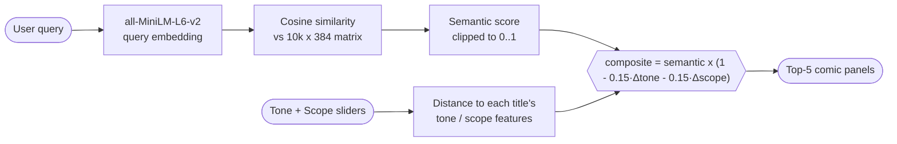

<div align="center">

# 🦸 IMAZINTHECOMICS

### Semantic comic recommendation engine

**Describe the story you want in plain English. Tune the vibe. Get matching comics.**

[](https://github.com/SlazzInC0de/imazinthecomicz/actions/workflows/tests.yml)


</div>

---

## 🚀 v2 (in progress): real data, Next.js + FastAPI

v1 below runs on a synthetic 10k catalog. v2 rebuilds the app on **real data**:

- **Manga / manhwa / manhua** from the public [AniList](https://anilist.co) GraphQL API (descriptions, genres, crowd-voted tags, covers, scores)
- **Western comics** from [Metron](https://metron.cloud) (series, publishers, genres, issue #1 covers)
- **Backend:** FastAPI (`backend/`) with the same text-first, vibe-tuned ranking, now driven by real tags
- **Frontend:** Next.js (`frontend/`) with search, tone/scope sliders, type filter, detail pages and "if you like this" recommendations

```
backend/
  ingest/anilist.py   fetch manga data (no key needed)
  ingest/metron.py    fetch Western series (free Metron account)
  normalize.py        map both sources onto one schema
  vibe.py             tone / scope from genres + tags
  build_index.py      merge, embed (all-MiniLM-L6-v2), save
  engine.py           search, similar, trending
  app.py              REST API
frontend/             Next.js app router UI
```

### Run it locally

```bash
# 1. Python deps
pip install -r backend/requirements.txt

# 2. Fetch data (AniList: ~2,000 titles in about a minute)
python -m backend.ingest.anilist --pages 40
# Metron needs credentials (PowerShell: $env:METRON_USERNAME="..."; $env:METRON_PASSWORD="...")
export METRON_USERNAME=your_user METRON_PASSWORD=your_pass
python -m backend.ingest.metron --limit 300 --covers

# 3. Build the index
python -m backend.build_index

# 4. Start the API
uvicorn backend.app:app --reload --port 8000

# 5. Start the web app (new terminal)
cd frontend && npm install && npm run dev   # http://localhost:3000
```

| Endpoint | Purpose |
|---|---|
| `GET /api/search?q=&tone=&scope=&kind=&k=` | semantic search with vibe sliders and type filter |
| `GET /api/comics/{id}` | one title |
| `GET /api/comics/{id}/similar` | nearest neighbours in embedding space |
| `GET /api/trending?kind=` | most popular titles |
| `GET /api/stats`, `GET /api/health` | catalog counts, readiness |

Backend tests: `python -m pytest backend/tests` (use a hashing embedder, no model download).

---

## ✨ What it does

Keyword search fails on queries like *"a blind lawyer fighting crime in Hell's Kitchen"*. IMAZINTHECOMICS embeds every title in a **10,000-comic catalog** into a 384-dimensional vector space and ranks by meaning, then lets you steer results with two **vibe sliders**:

- 🎭 **Tone**: campy ➡ grimdark
- 🌌 **Scope**: street-level ➡ cosmic

All of it runs locally with a pre-built index, wrapped in a hand-styled, comic-panel Streamlit UI.

## 🧠 How ranking works



- **Text is the gatekeeper.** The semantic score decides what is relevant.
- **Vibe is the fine-tuner.** Sliders can lower a match by at most 30% combined, so they reorder close results without overriding meaning.
- **Tone and scope are derived from metadata** (`vibe.py`): genre keywords plus age rating map each title into [0, 1]. For example, *Horror / Supernatural* lands at tone 0.85, scope 0.70, while *Comedy / Slice of Life* sits at tone 0.00, scope 0.20.

## 📏 Evaluation

A catalog this size says nothing about quality on its own, so the repo ships a labelled benchmark: [`eval/queries.json`](eval/queries.json) holds 20 natural-language queries, and a title counts as relevant when its genre, publisher or art style matches the query's rule. Seventeen queries are **paraphrases** that avoid the genre word on purpose ("a detective solving murders" for *Mystery / Crime / Noir*), so they test meaning rather than keyword overlap.

`python eval/evaluate.py` runs the real model in CI and writes [`eval/results.md`](eval/results.md):

| Ranker | P@5 | P@10 | MRR |
|---|---:|---:|---:|
| Random (expected) | 0.08 | 0.08 | n/a |
| TF-IDF keywords | 0.34 | 0.34 | 0.41 |
| **Semantic engine** | **0.45** | **0.41** | **0.58** |

On paraphrase queries alone, semantic search reaches P@5 **0.39 vs 0.22** for TF-IDF.

**Where it still fails, and why:**
- *"an ordinary person transported to another world"* (isekai), *"ancient gods and legendary myths"* and *"growing up as a teenager"* score 0 at P@5. The likely cause: each title is embedded from a one-line description generated from its metadata, so a niche genre word like "Isekai" carries little meaning for a general-purpose model.
- *"costumed heroes protecting the city"* also misses, probably because the only signal in each description is the single word "Superhero".
- Keyword search still wins on literal queries ("watercolor": 1.00 vs 0.40).

**Takeaways:** richer documents (real plot synopses) matter more than model size here, and a hybrid score (semantic + TF-IDF) would cover the literal-query weakness. Both are on the roadmap.

> Labels are rule-based and the catalog is synthetic, so these numbers measure retrieval behaviour, not real-world recommendation accuracy.

## 🧭 Design decisions

| Decision | Why | Trade-off / alternative |
|---|---|---|
| **Pre-computed index committed to the repo** | The app boots in seconds without re-embedding 10k titles | ~18 MB of binaries in git; regenerate with `build_index.py` when the CSV changes |
| **Brute-force NumPy cosine** over a vector DB | 10k × 384 is ~15 MB; one matrix-vector product is fast enough | Linear in catalog size; FAISS or HNSW past ~100k titles |
| **Sliders multiply, capped at -30%** | Meaning stays the gatekeeper; vibe only reorders close matches | Sliders cannot surface a weak text match, by design |
| **Tone and scope from metadata rules** | Gives the sliders real signal without labelled data | Hand-tuned weights; learning them from plot text would be better |
| **`all-MiniLM-L6-v2`** | Small (80 MB), CPU-friendly, good general sentence embeddings | Weak on niche genre jargon (see evaluation) |
| **Model stubbed in unit tests** | Ranking logic is tested in under a second without torch | The real model is exercised only by the evaluation job |

## ⚡ Engineering notes

- **Offline indexing**: `build_index.py` turns catalog metadata into a descriptive document per title, embeds all 10k once and caches `vector_cache.npy` + `catalog_cache.pkl`.
- **Pure NumPy retrieval**: similarity is a single matrix-vector product, with no per-query PyTorch tensor conversion.
- **Load once**: `st.cache_resource` keeps the model and matrix in memory across reruns.
- **Safe rendering**: every catalog value is HTML-escaped before it is injected into the custom panel markup.
- **Tested without the model**: 9 pytest cases (97% coverage of `engine.py` and `vibe.py`) stub the encoder, so ranking logic runs in CI in under a second.

## 🚀 Run locally

```bash
git clone https://github.com/SlazzInC0de/imazinthecomicz.git
cd imazinthecomicz
python -m venv .venv && source .venv/bin/activate   # Windows: .venv\Scripts\activate
pip install -r requirements.txt

streamlit run imazinthecomics.py
```

The prebuilt index ships with the repo. To rebuild it after editing `comics.csv`:

```bash
python build_index.py
```

**CLI smoke test**

```bash
python smoke_test.py --query "cosmic horror with elder gods" --tone 0.9 --scope 0.8
```

**Unit tests and evaluation**

```bash
pip install pytest pytest-cov scikit-learn
pytest -v --cov=engine --cov=vibe
python eval/evaluate.py      # downloads the model on first run
```

## 🗂️ Dataset

`comics.csv` is a **synthetic catalog** of 10,000 titles (manga, manhua, webtoons, Western comics) with writer, artist, publisher, year, format, color style, genre, age rating, page count and more. It exists to exercise the retrieval pipeline at a realistic scale.

## 📁 Project structure

```text
imazinthecomicz/
├── imazinthecomics.py   # Streamlit app (UI + styling)
├── engine.py            # SemanticMatrixEngine: load index, rank queries
├── vibe.py              # Tone / scope feature derivation
├── build_index.py       # Offline embedding + cache builder
├── smoke_test.py        # CLI query runner
├── tests/               # pytest suite (model stubbed)
├── eval/                # labelled queries, evaluation script, results
├── comics.csv           # 10k-title catalog
├── catalog_cache.pkl    # Prebuilt catalog with features
└── vector_cache.npy     # Prebuilt 10k x 384 embeddings
```

## 🗺️ Roadmap

- [ ] Deploy on Streamlit Community Cloud
- [ ] Real plot synopses for richer embeddings
- [ ] Hybrid semantic + TF-IDF scoring for literal queries
- [ ] Learn tone and scope from plot summaries instead of metadata rules
- [ ] Filters for format, language and age rating
- [ ] FAISS index for catalogs beyond 100k titles

## 📄 License

MIT © [Suryansh Verma](https://github.com/SlazzInC0de)
