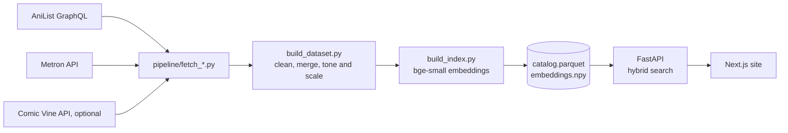

<div align="center">

# IMAZINTHECOMICS

**Describe a story. Get manga, manhwa, manhua and Western comics that tell it.**

[](https://github.com/SlazzInC0de/imazinthecomicz/actions/workflows/tests.yml)
[](https://github.com/SlazzInC0de/imazinthecomicz/actions/workflows/data.yml)

</div>

Keyword search fails on queries like *"a detective who can see ghosts"* when the synopsis says *"spirits"* and *"murder cases"*. This project ranks real titles by what their synopsis is about, and still finds a series when you type its name.

**Catalog:** 16,964 titles: 12,201 manga, 3,160 manhwa, 925 manhua (AniList) and 678 Western series (Metron), each with a synopsis, genres and a cover.

## What changed in v2

Version 1 was a Streamlit demo over 10,000 generated rows with made-up titles, embedded from a one-line template. Version 2 is rebuilt end to end:

| | v1 | v2 |
|---|---|---|
| Data | Synthetic CSV | Real titles from AniList and Metron, with synopses, ranked themes, creators and covers |
| What gets embedded | Title, genre, publisher | Synopsis, genres, themes, creators |
| Ranking | Embeddings only | Embeddings + BM25, exact title bonus, popularity tie-break |
| Vibe sliders | Hand-set by genre | Percentiles from AniList's ranked themes, off by default |
| Model | all-MiniLM-L6-v2 on PyTorch | bge-small-en-v1.5 on ONNX (fastembed), no PyTorch at runtime |
| App | Streamlit | FastAPI service + server-rendered Next.js site |
| Data files | Pickle (runs code on load) | Parquet + NumPy |

## How it works



**Pipeline** (`pipeline/`, runs in GitHub Actions): pulls titles in popularity order, drops light novels, adult titles and entries without a real synopsis, merges the sources into one schema and embeds a document per title. The raw API dumps are committed, so rebuilding the index does not hit the APIs again.

**Search** (`api/app/engine.py`): every query is scored by cosine similarity against the embedding matrix and by BM25 over the same text (the title and alternative titles are repeated three extra times on top of the document). Cosine is min-max scaled over the filtered candidates, BM25 is divided by its top score, and the two are blended 70/30. An exact title match gets a bonus and popularity breaks near ties. Results show which genres or themes your words hit. There is no "92% match" badge: the benchmark showed raw cosine scores of relevant and irrelevant hits overlap almost completely, so a percentage would be invented.

**Tone and scale**: AniList ranks how strongly each theme applies (Tragedy 87%, Iyashikei 92%). Known themes and genres push a title toward darker or lighter, and grounded or world-ending, weighted by rank. Each title then gets its percentile in the catalog, so the slider middle is the catalog middle. Sliders are off until switched on and scale scores by at most 35% each.

**Similar titles**: nearest neighbours in embedding space, skipping entries of the same franchise so "If you liked Naruto" is not five Naruto sequels.

## Benchmark

`eval/queries.json` has 35 queries. 30 describe a story without naming the genre or theme ("spirits haunting an old house" for Horror / Ghost), 5 are series names. Relevance comes from AniList's own labels. `python eval/evaluate.py` runs in CI after every catalog build and writes [`eval/results.md`](eval/results.md).

| Ranker | P@5 | P@10 | MRR |
|---|---:|---:|---:|
| Random | 0.04 | 0.04 | n/a |
| Keyword (BM25) | 0.50 | 0.44 | 0.69 |
| Semantic (embeddings) | 0.49 | 0.45 | 0.73 |
| **Hybrid (served)** | **0.57** | **0.49** | **0.79** |

On descriptive queries alone the blend lifts P@5 from 0.45 (keyword and semantic alike) to 0.53. Typing a series name puts it first every time (MRR 1.00).

What the numbers do not show:

- Relevance comes from AniList labels, so a Western series that fits a query still counts as a miss (it has no AniList tags). The scores are a floor, not a ceiling.
- The raw cosine of relevant and irrelevant top-10 hits overlaps almost completely (median 0.611 vs 0.608), so the site shows no "match %" badge. Rank order carries the signal, a single score does not.

## Security

Checked against my pre-launch list before deploying:

- **Read-only API**, GET only, no database, no user accounts, nothing to inject into. Every declared parameter is validated (lengths, enums, ranges, id pattern) and an invalid value is a 422. Unknown parameters are ignored.
- **Rate limiting per visitor.** The Next.js server forwards the visitor's IP with a shared `PROXY_KEY`; the API only believes that IP when the key matches (constant-time compare), otherwise it limits by the real connection. Spoofing `X-Client-IP` does nothing.
- **CORS** allows only the site's origin, including on 429 responses. **Security headers**: the API sends `default-src 'none'` CSP, HSTS, `nosniff`, `X-Frame-Options` and `no-referrer`. The site adds a per-request nonce CSP (no inline script runs without it, no third-party scripts, images only from the AniList, Metron and Comic Vine CDNs), HSTS, a permissions policy and `frame-ancestors 'none'`.
- **No stack traces** reach clients, API docs are off in production, no source maps in the browser bundle.
- **No pickle.** v1 loaded a committed `.pkl`, which executes code on load. v2 uses Parquet and `.npy`.
- **Secrets** (Metron token, Comic Vine key, HF token) live in GitHub secrets. gitleaks scans pushes to `main` and `v2` and every pull request; Dependabot and `npm audit` watch dependencies.
- **JSON-LD** on comic pages escapes `<` so a synopsis cannot close the script tag.

## Run it locally

```bash
# API (needs data/ from the catalog workflow, or run the pipeline yourself)
pip install -r api/requirements-dev.txt
uvicorn app.main:app --app-dir api --reload        # http://127.0.0.1:8000/api/health
python -m pytest api/tests tests                    # no model download needed

# Web
cd web && cp .env.example .env.local && npm install && npm run dev   # http://localhost:3000

# Rebuild the catalog yourself
pip install -r pipeline/requirements.txt
python pipeline/fetch_anilist.py
COMICVINE_API_KEY=... python pipeline/fetch_comicvine.py   # optional
python pipeline/build_dataset.py && python pipeline/build_index.py
python eval/evaluate.py
```

## Deploy

1. **API on Hugging Face Spaces** (free CPU, 16 GB RAM). Create a write token at huggingface.co/settings/tokens. In this repo: Settings > Secrets and variables > Actions, add secret `HF_TOKEN` and variable `HF_SPACE` (for example `slazz/imazinthecomicz-api`). The **Deploy API** workflow builds the Space on every push to `main` that touches `api/` or `data/`. In the Space settings add `ALLOWED_ORIGINS` (your Vercel URL) and `PROXY_KEY` (any long random string).
2. **Web on Vercel.** Import the repo, set the root directory to `web`, and add env vars `API_URL` (`https://<user>-<space>.hf.space`), `PROXY_KEY` (same value) and `SITE_URL` (the Vercel or custom domain).
3. **Western comics** come from Metron (secret `METRON_API_TOKEN`, free account, about 20 requests a minute). A Comic Vine key (`COMICVINE_API_KEY`) adds more. Run the **Build catalog** workflow with *refresh* ticked to fetch again.

## Project layout

```
pipeline/   fetchers, dataset builder, tone/scale scoring, index builder
data/       raw API dumps, catalog.parquet, embeddings.npy, meta.json (built by CI)
api/        FastAPI service, engine, rate limiter, tests, Dockerfile
eval/       benchmark queries, evaluate.py, results.md
web/        Next.js site
tests/      pipeline tests
```

## Credits

Data from [AniList](https://anilist.co), [Metron](https://metron.cloud) and [Comic Vine](https://comicvine.gamespot.com). Covers belong to their publishers and are shown from the sources' CDNs. Fonts: Archivo and Shantell Sans (SIL Open Font License).

MIT licensed. Built by Suryansh Verma.
